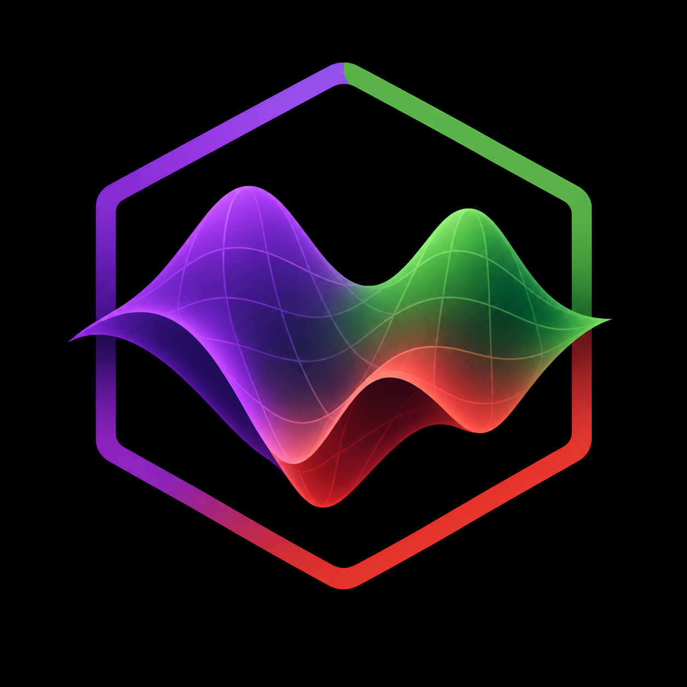

<p align="center">
  
</p>

[](https://julianonconvex.github.io/NonconvexCore.jl/stable)
[](https://julianonconvex.github.io/NonconvexCore.jl/dev)
[](https://github.com/JuliaNonconvex/NonconvexCore.jl/actions)
[](https://codecov.io/gh/JuliaNonconvex/NonconvexCore.jl)
[](https://github.com/JuliaTesting/Aqua.jl)
[](https://github.com/invenia/BlueStyle)
[](https://github.com/aviatesk/JET.jl)

# NonconvexCore.jl

The foundation of the JuliaNonconvex ecosystem

Models, automatic differentiation, function modifiers, solver capabilities and convergence criteria shared by every solver package.

NonconvexCore.jl is part of the [JuliaNonconvex](https://github.com/JuliaNonconvex) ecosystem built on [NonconvexCore.jl](https://github.com/JuliaNonconvex/NonconvexCore.jl).

## Quick start

```julia
using NonconvexCore

m = Model(x -> sum(x .^ 2))
addvar!(m, [-5.0, -5.0], [5.0, 5.0])
r = optimize(m, NelderMeadAlg(), [1.0, 1.0])
```

## Documentation

The full documentation is available at [https://julianonconvex.github.io/NonconvexCore.jl/stable](https://julianonconvex.github.io/NonconvexCore.jl/stable) (stable) and [https://julianonconvex.github.io/NonconvexCore.jl/dev](https://julianonconvex.github.io/NonconvexCore.jl/dev) (development).

## Installation

```julia
using Pkg
Pkg.add("NonconvexCore")
```
